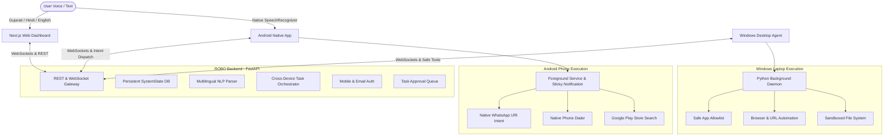

# ROBO AI Assistant — System Architecture

ROBO is a modular, zero-token personal AI agent ecosystem that operates across **Web**, **Android**, and **Windows Laptop**.

## Key Architectural Principles

1. **Zero-Token, Zero-Friction Usability**:
   - Designed for non-technical users.
   - Requires **no WhatsApp Business Cloud API tokens**, no Facebook developer accounts, no Twilio telecom credit cards.
   - Uses native Android intents (`whatsapp://send`, `tel:`, `market://search`) and universal web protocols.

2. **Persistent Desired Agent State**:
   - Master ON/OFF toggle is persisted in SQLite (`SystemState` table).
   - Closing the browser tab does **not** reset the state.
   - Connected devices stay synchronized and refuse new tasks when the agent is turned OFF.

3. **Multilingual Voice Pipeline**:
   - Full support for **Gujarati (ગુજરાતી)**, **Hindi (हिन्दी)**, **English**, and code-switched phrases (Gujlish & Hinglish).
   - Uses browser Web Speech API (`gu-IN`, `hi-IN`, `en-IN`) on web and Android native `SpeechRecognizer` on phone.
   - Spoken feedback via Web Speech Synthesis and Android `TextToSpeech`.

4. **Real Background Operation**:
   - **Android**: Declared Foreground Service (`RoboBackgroundService`) with sticky notification and `FOREGROUND_SERVICE_DATA_SYNC` type, maintaining WebSocket connection even when screen is locked.
   - **Windows**: Independent background Python daemon (`agent.py`) with optional Windows Startup folder integration.

5. **Approval Gates for Sensitive Operations**:
   - Actions like drafting email replies or placing direct calls require explicit confirmation in the Dashboard Approval Queue.
